# 4DSTEM

This guide covers 4DSTEM data acquisition using the Dectris Arina detector on the Spectra 300 at Stanford SNSF. 4DSTEM records a full convergent beam electron diffraction (CBED) pattern at every scan position, producing a 4-dimensional dataset (2D scan x 2D diffraction). Images recorded by Sangjoon Bob Lee during training by Andrew Barnum; instructions written by Sangjoon Bob Lee.

**Prerequisite:** Complete [TEM (Spectra)](../spectra_TEM/index.md) column alignment and [STEM (Spectra)](../spectra_STEM/index.md) probe correction before starting this guide.

**Acronyms:**

- `mulXY` - Multifunction X/Y knobs on hand panel
- `TEMUI` - TEM User Interface (software)
- `CBED` - Convergent Beam Electron Diffraction

## Overview

| Phase | Procedures | Time |
| ----- | ---------- | ---- |
| [Part 1: Detector setup](#part-1-detector-setup) | Retract CETA, remote into the Arina PC, initialize Arina, set data path, turn on HV | 5 min |
| [Part 2: Beam setup](#part-2-beam-setup) | Enable descan, retract HAADF | 2 min |
| [Part 3: Acquisition](#part-3-acquisition) | Insert detector, acquire diffraction data | varies |
| [Part 4: End session](#part-4-end-session) | Retract the Arina detector, turn HV off, 4DSTEM checklist before leaving | 2 min |

## Part 1: Detector setup

### 1.1 Retract CETA detector

> [!CAUTION]
> **IMPORTANT:** Retract the CETA camera before inserting the Arina detector. Both detectors occupy the same physical space below the column. If the CETA is not retracted, inserting the Arina will crash both detectors. Do **not** skip this step.

1. On the bottom left computer, open the blanker/shutter software (red square icon with white T).
2. Click the CETA icon to retract the CETA detector.

   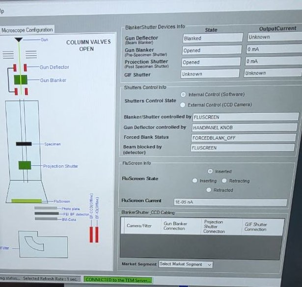

   The photo above shows the CETA retracted.

3. Visually verify the CETA camera position is retracted from the diagram.
4. In `TEMUI`, locate the `STEM Detector (User)` panel and verify all detectors are retracted:
   - HAADF: Retracted
   - BF-S (Bright Field): Retracted
   - DF-S (Dark Field): Retracted

### 1.2 Connect to the Arina PC

The Arina PC controls the detector. Reach it from the microscope computer through Remote Desktop.

- [ ] **Open Remote Desktop**

  1. On the microscope computer, click the `Remote Desktop Connection` icon in the taskbar.

     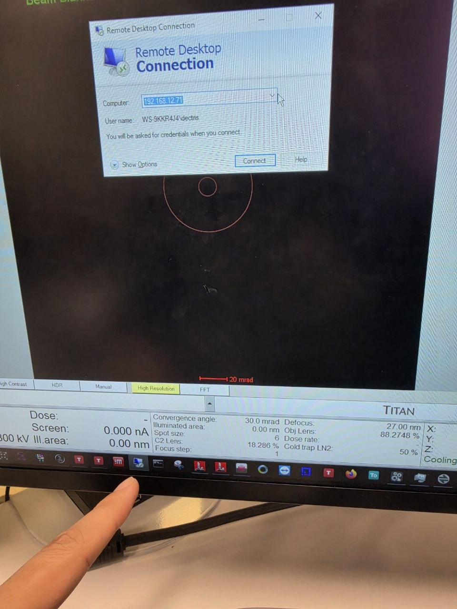

  2. Confirm `Computer` is `192.168.12.71` and `User name` is `WS-9KKR4J4\dectris`. Click `Connect`.

- [ ] **Log in**

  1. Enter the password and click `OK`.

     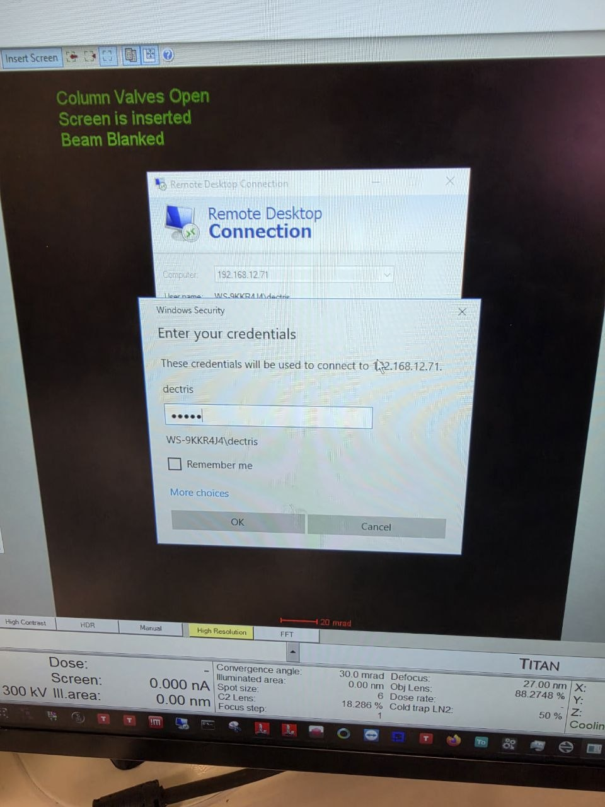

     > **NOTE:** Ask SNSF staff for the password, or message @bobleesj if you are an authorized previous Arina user.

### 1.3 Check the Electron Microscope Gateway

The Electron Microscope Gateway links the microscope computer to the Arina PC.

- [ ] **Open the Gateway**

  1. On the microscope computer, click the `Electron Microscope Gateway` icon in the taskbar tray (bottom right).

     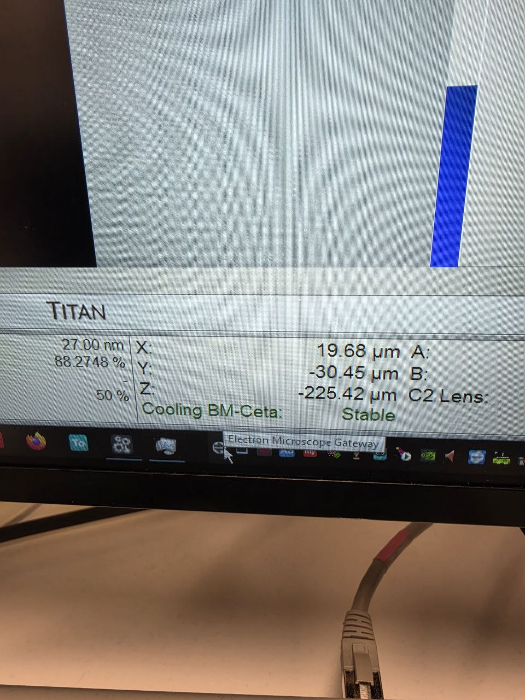

  2. Confirm the Gateway window opens, then close it.

     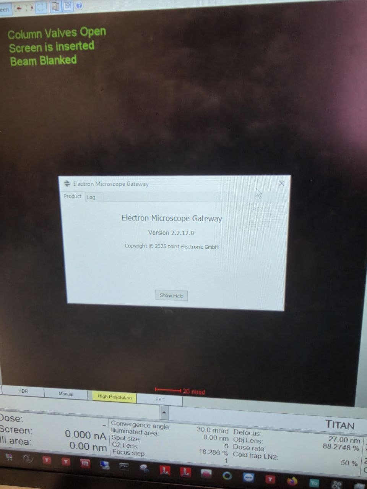

### 1.4 Initialize the Arina detector

- [ ] **Initialize the detector**

  1. On the Arina PC, click `Chrome` in the taskbar. The `DECTRIS Configuration Interface` opens.
  2. Go to `System`, then `Detector`. Click `Initialize detector`.
  3. Wait until `State` reads `idle`.

     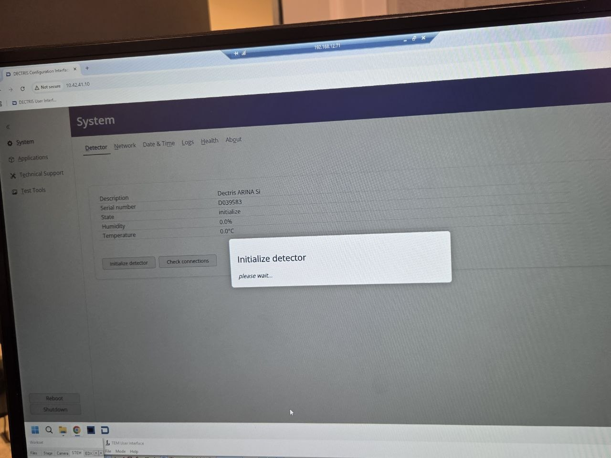

### 1.5 Open NOVENA Acquire and set the data path

- [ ] **Open NOVENA Acquire**

  1. On the Arina PC, click the `DECTRIS Novena Acquire` icon (black square next to Chrome).

     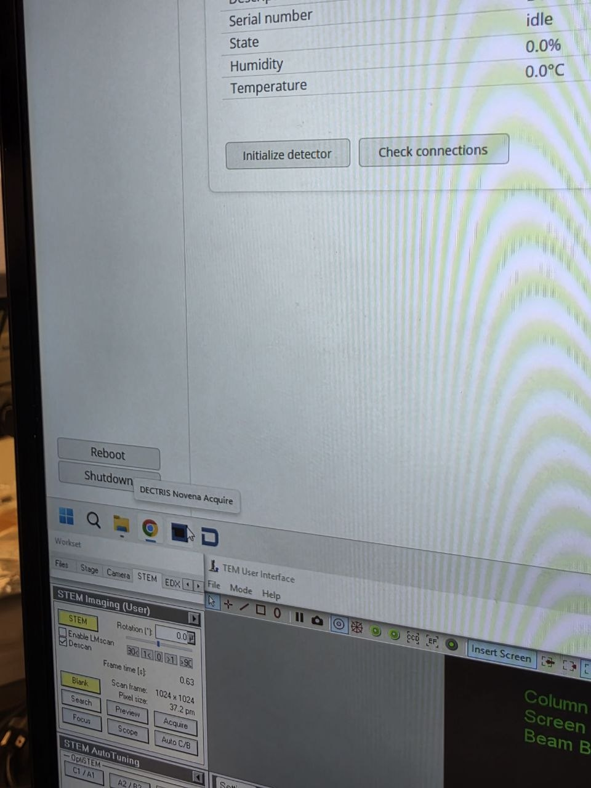

  2. Wait until the log at the bottom reads `initialization OK`.

- [ ] **Set the data path**

  1. In `Data Path`, click `...` next to `Dir` and choose a folder on `D:`.
  2. Type a file name in `Prefix`. See [folder and file naming convention](#folder-and-file-naming-convention).

     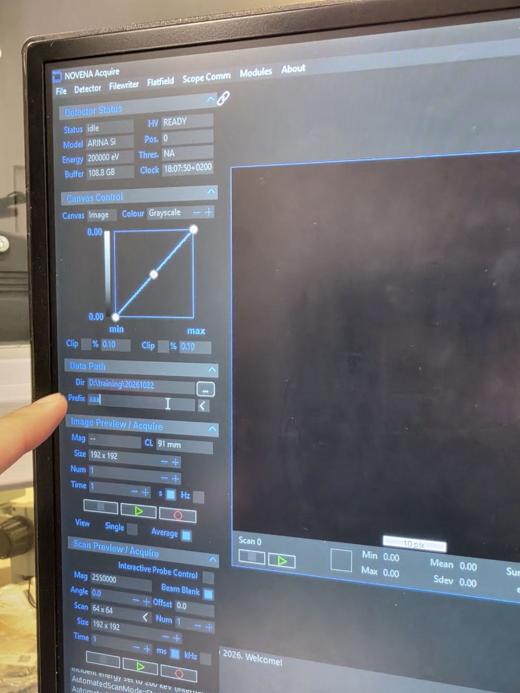

#### Folder and file naming convention

I use the following patterns to help me remember what each dataset is when I share data or revisit a session months later.

> I keep everything lowercase: folder names, sample names, operator names, all tokens. That way I never wonder whether a file is `Gold`, `gold`, or `GOLD`, shell paths stay simple, and names sort cleanly.

**Folder name:** `YYYYMMDD_{sample}_{experiment}[_{operators}]`

I lead with the most important keywords: the sample first, then the experiment or focus. I also add the operators (initials or short names) at the end. It records who was in the room, which helps me remember the surrounding context (conversations, troubleshooting, follow-up questions) months later.

| Example | Meaning |
|---|---|
| `20260428_gold_drift_ptycho` | Gold sample, drift study via ptychography on Apr 28, 2026 |
| `20260428_gold_drift_ptycho_dasol_corrie` | Same session, with Dasol and Corrie noted |
| `20260512_mos2_ptycho_bob` | MoS₂ sample, ptychography, solo session by Bob on May 12 |

**File name:** `{voltage}_{convergence}_{scan-params}_{notes}.h5` (or `.mat`, `.raw`)

I order tokens from the largest concept (session-wide) to the smallest (per-scan). Voltage applies to the whole session, convergence and camera length apply per experiment, and scan dimensions and dwell time change per scan. Read left to right, the filename zooms in from the broadest setting to the most specific.

| Token | Meaning | Example | Scope |
|---|---|---|---|
| `{n}kev` | Accelerating voltage | `300kev`, `120kev` | session-wide |
| `{n}mrad` | Convergence angle | `30mrad`, `1.5mrad` | per-experiment |
| `cl{n}m` | Camera length | `cl0.4m`, `cl1.05m` | per-experiment |
| `{n}x{n}` | Scan dimensions | `128x128`, `512x512` | per-scan |
| `{n}us` | Dwell time (usually µs on Arina) | `5us`, `200us` | per-scan |

I only encode parameters that stay constant for the whole scan. I skip things that drift or change over time (e.g., defocus), since a fixed filename token says little about them, and I do not record them in the `h5` metadata either.

| Example | Meaning |
|---|---|
| `300kev_30mrad_128x128_5us` | 300 kV, 30 mrad probe, 128 by 128 scan, 5 µs per pixel |
| `300kev_1.5mrad_64x64_nbed` | 300 kV, nanobeam diffraction at 1.5 mrad |
| `300kev_30mrad_256x256_drift1` | First scan in a drift series |

Starting each session with these patterns keeps my names sorted in the file browser and easy to search.

### 1.6 Turn on the detector high voltage

> [!CAUTION]
> **IMPORTANT:** Turn on the high voltage before acquiring. With `HV` set to `OFF`, the detector records no data. `HV` must be `OFF` by the end of the session ([4.2](#42-turn-off-the-detector-high-voltage)).

- [ ] **Turn on HV**

  1. In NOVENA Acquire `Detector Status`, turn `HV` on. Click `Yes` to confirm.

     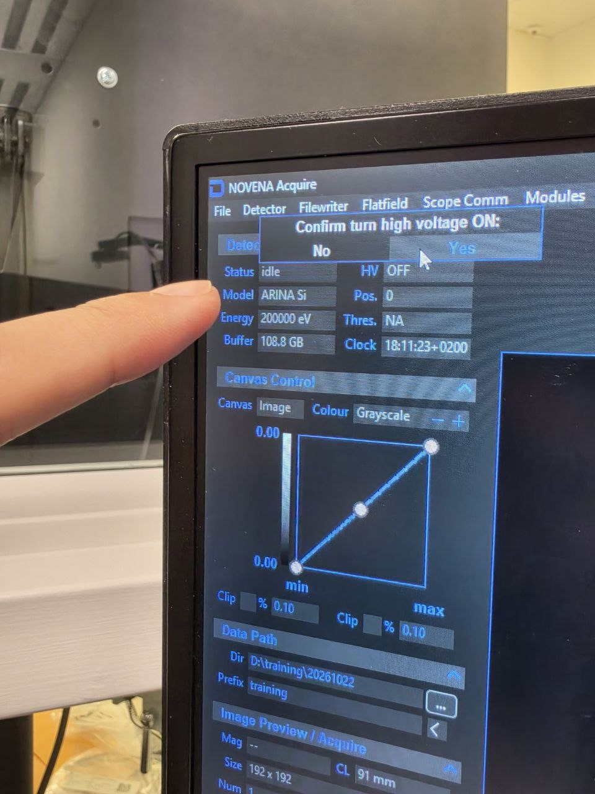

  2. Confirm `HV` reads `READY`.

## Part 2: Beam setup

The [STEM (Spectra)](../spectra_STEM/index.md) guide sets a 30 mrad convergence angle by default, which suits most 4DSTEM experiments (e.g., ptychography). If you need a smaller convergence angle for separated Bragg disks, see [Nanobeam diffraction](nanobeam.md) before continuing.

### 2.1 Enable descan

1. In `TEMUI`, locate the `STEM Imaging (Expert)` panel and enable `Descan`.

### 2.2 Retract HAADF

1. In `TEMUI`, retract the HAADF detector. The HAADF ring would block electrons from reaching the Arina detector below.

## Part 3: Acquisition

### 3.1 Insert detector and configure scan

1. On the Arina hand panel, press `Insert` to move the detector into position. The green "Inserted" light confirms the detector is in place.

2. On the scan control box, press `EDS Scan`.

   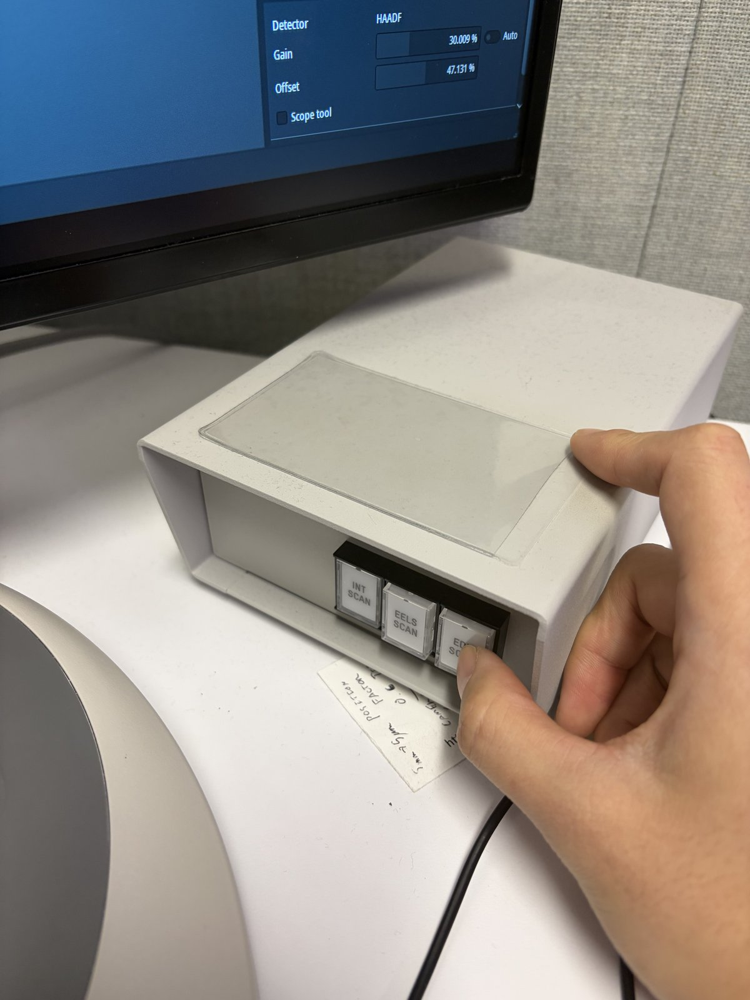

3. When you are ready to take a picture, press `R1` on the hand panel to lift the fluorescent screen. The Arina detector sits below the screen.

### 3.2 Acquire data

NOVENA Acquire has two panels with the same buttons: green ▶ previews without saving, red ○ records and saves.

- `Image Preview / Acquire`: one diffraction pattern, beam parked.
- `Scan Preview / Acquire`: the 4DSTEM scan, one pattern per scan position.

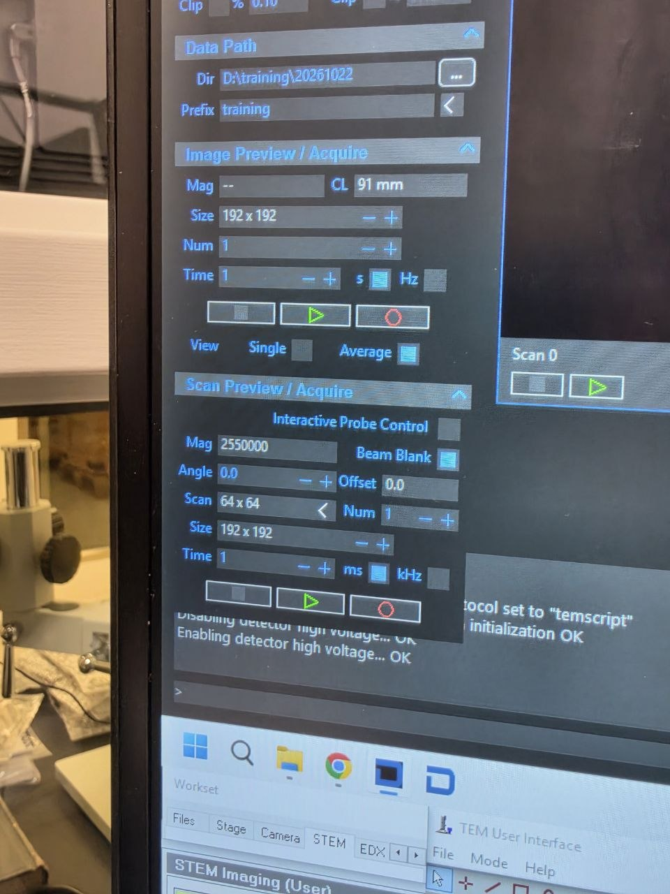

- [ ] **Center the beam**

  1. In `Image Preview / Acquire`, click green ▶.
  2. Verify the central beam is centered on the detector. If not, center it with `mulXY` in diffraction shift.

- [ ] **Preview the scan**

  1. In `Scan Preview / Acquire`, set `Scan` (e.g., `64 x 64`) and `Time` (dwell time per position).
  2. Click green ▶. Nothing is saved.

- [ ] **Record**

  1. Click red ○ in `Scan Preview / Acquire`. The dataset saves to the `Data Path`.

- [ ] **Verify the files saved**

  1. Open the `Data Path` folder. Confirm both `.h5` and `_master.h5` files are present for the latest scan.
  2. Confirm neither file is 0 KB. If one is, re-run the scan.

  > **NOTE:** NOVENA occasionally finishes a scan without writing the file. Check after every recording.

### 3.3 Quick analysis

1. In the NOVENA software, use `Rebin` and `Reprocess` for a quick check of the acquired data. For detailed analysis, export the data for processing with external software (py4DSTEM, etc.).

### 3.4 Transfer data to your USB

See [how to transfer data to your USB](../data-transfer/index.md) for getting the Arina 4DSTEM datasets and HAADF images off the microscope computers.

### 3.5 View your data on a Mac with Live4DSTEM

`Live4DSTEM` is a macOS app for browsing Arina data at 60 fps on a MacBook. It shows the diffraction pattern, virtual image, derived images (BF, ABF, ADF, CoM, DPC, iDPC), and acquisition metadata.

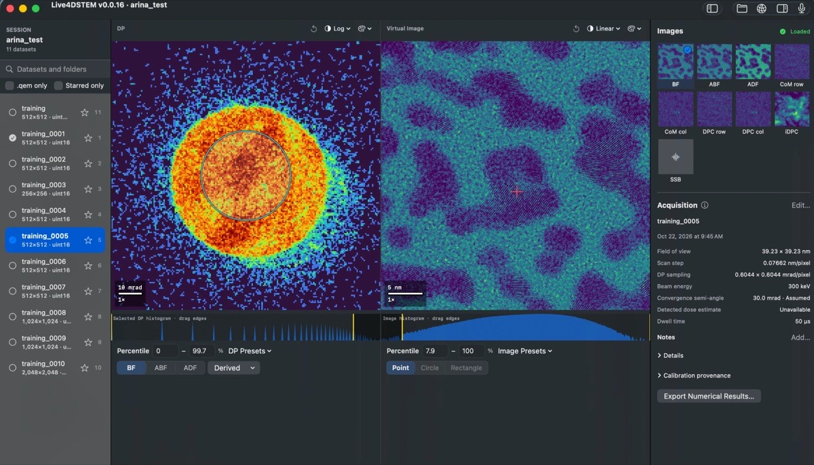

For the source code, message @bobleesj on Slack or email Sangjoon Bob Lee.

## Part 4: End session

### 4.1 Retract the Arina detector

- [ ] **Retract the detector**

  1. On the Arina hand panel, press `Retract`. The green "Retracted" light turns on.

     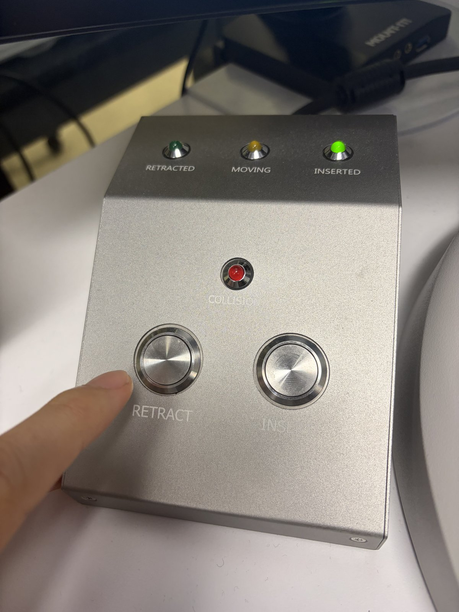

### 4.2 Turn off the detector high voltage

> [!CAUTION]
> **IMPORTANT:** `HV` must be `OFF` by the end of the session.

- [ ] **Turn off HV**

  1. In NOVENA Acquire `Detector Status`, turn `HV` off.
  2. Confirm `HV` reads `OFF`.

  > **NOTE:** Leave the Arina detector powered on. Do **not** power it off at the end of a session.

### 4.3 4DSTEM checklist before leaving

- [ ] Arina detector is retracted, verified by the green "Retracted" light on the hand panel.
- [ ] `HV` reads `OFF` in NOVENA Acquire.
- [ ] Your datasets are saved: both `.h5` and `_master.h5` files are present with non-zero sizes.
- [ ] Your data is copied off the Arina PC ([data transfer](../data-transfer/index.md)).
- [ ] The Arina detector is left powered on (blue light on).

### 4.4 Close session

Follow the steps in [End session](../spectra_STEM/index.md#part-4-end-session).

## Appendix: Manually power the detector on or off

The Arina detector stays on between sessions. Use these steps only if it is off (e.g., after a power outage) or SNSF staff ask you to power it down.

> [!CAUTION]
> If you are doing this for the first time, work with a trainer supervising.

- [ ] **Power on**

  1. Open the Spectra 300 instrument enclosure.

     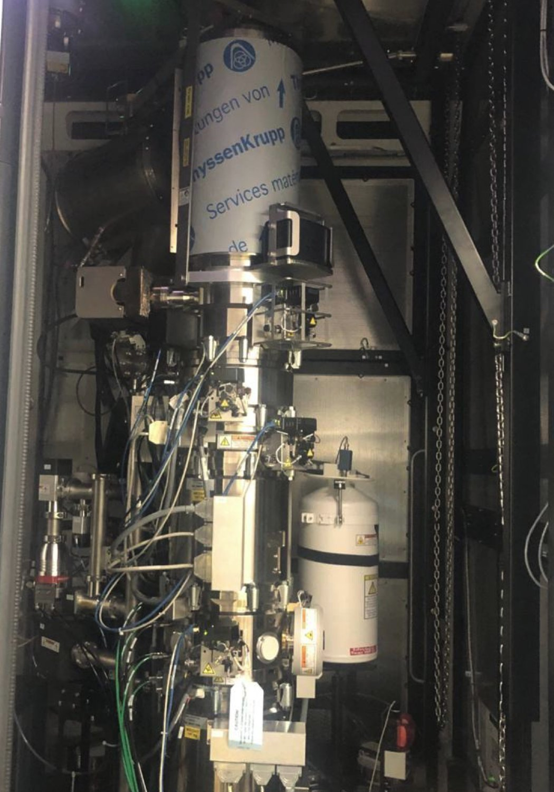

  2. Locate the Dectris Arina detector unit.

     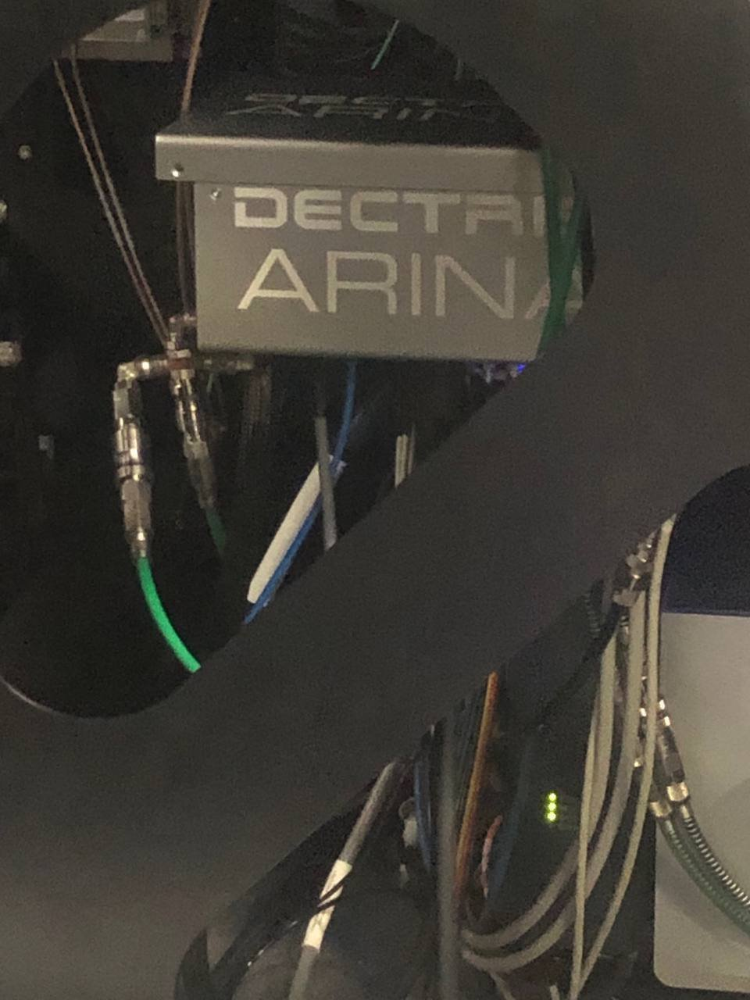

  3. Press and hold the button below the detector. The button stays pressed in and the blue light turns on.

- [ ] **Power off**

  1. Open the Spectra 300 instrument enclosure.
  2. Press and hold the button below the detector. The button releases and the blue light turns off.

## Changelog

- Oct 23, 2026 - Update for the new Arina PC: Remote Desktop login, Electron Microscope Gateway, DECTRIS Configuration Interface, NOVENA Acquire data path, HV on and off, preview vs. record, 4DSTEM checklist before leaving, and Live4DSTEM. Move nanobeam diffraction to its own page and manual detector power on/off to the appendix
- Feb 28, 2026 - Rewrite SOP by Sangjoon Bob Lee with full procedural instructions, inline FAQ dropdowns, and new images
- Dec 10, 2025 - First draft and images shared by Guoliang Hu
