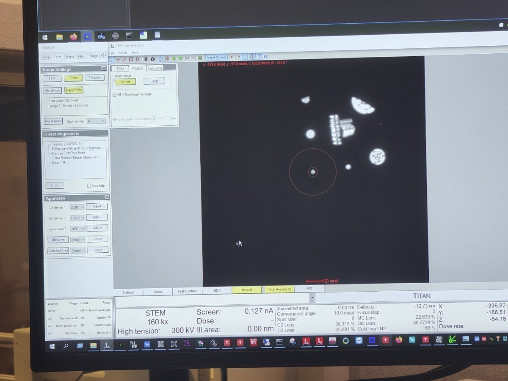
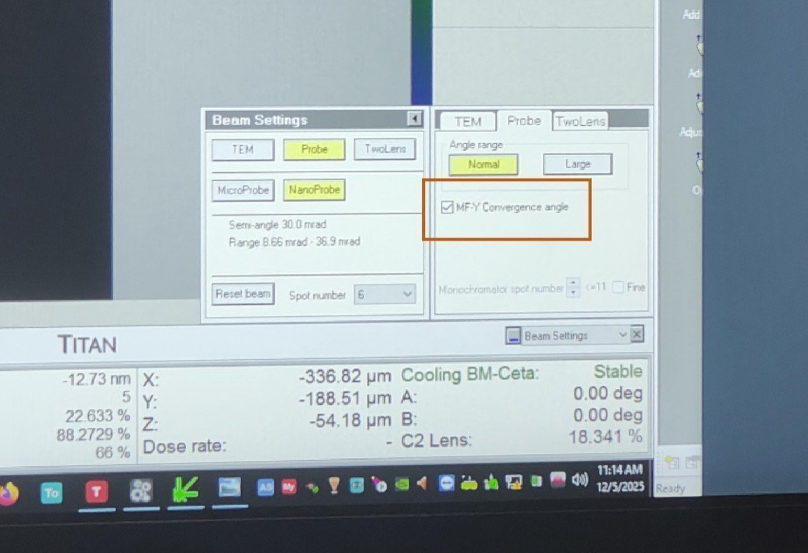

# Nanobeam diffraction

Nanobeam diffraction (NBED) is a 4DSTEM experiment that uses a small convergence angle so the Bragg disks in each diffraction pattern stay separated and can be indexed. This page covers the beam settings that differ from the 30 mrad STEM default. For detector setup, acquisition, and end of session, follow [4DSTEM](index.md).

**Prerequisite:** Complete [4DSTEM Part 1: Detector setup](index.md#part-1-detector-setup) and [Part 2: Beam setup](index.md#part-2-beam-setup) first. Then return to [Part 3: Acquisition](index.md#part-3-acquisition) after these steps.

<strong>Why change the convergence angle for 4DSTEM?</strong>

The convergence angle depends on the type of 4DSTEM experiment. For ptychography, 30 mrad (the same as standard STEM) works well because overlapping disks are part of the reconstruction. For nanobeam diffraction, where separated Bragg disks are needed to index reflections, a much smaller angle is used, typically 1 to 10 mrad depending on the material and the required disk separation.

**Interactive demo:** Explore how convergence angle affects the CBED pattern at [bobleesj.github.io/electron-microscopy-website/cbed](https://bobleesj.github.io/electron-microscopy-website/cbed)

## Configure beam for nanobeam diffraction

The default STEM setup uses C2 = 70 and 30 mrad convergence angle. For nanobeam diffraction, reduce both to get separated Bragg disks. The table below shows typical values:

| Parameter | STEM default | Nanobeam diffraction |
|-----------|-------------|---------------------|
| C2 aperture | 70 | 50 |
| C3 aperture | 1000 | 30 |
| Convergence angle | 30 mrad | ~10 mrad |
| Beam current | ~0.150 nA | ~0.032 nA |
| Camera length | 91 mm | 230 mm |

<strong>Why change the C2 aperture?</strong>

The C2 aperture limits the angular range of electrons entering the probe-forming optics. A smaller aperture (50 vs 70) blocks more off-axis electrons, producing a more coherent beam with cleaner diffraction patterns at each probe position. The C2 aperture size and convergence angle are proportional (approximately 7:1 ratio, e.g. C2 = 70 gives ~10 mrad).

> TODO: Confirm the C2 aperture to convergence angle ratio with staff

1. In `TEMUI`, go to `Tune` tab, then `Apertures`. Change C2 from 70 to 50, and C3 from 1000 to 30.

   

2. In `Beam Setting`, click `MF-Y Convergence Angle`. Use the `mulY` knob to adjust the convergence angle to 10 mrad, then click `MF-Y Convergence Angle` again to deselect.

   

3. Adjust beam current: in `TEMUI`, go to `Mono`, click `Focus`, and use the intensity knob to set the current to ~0.032 nA.

4. Set the camera length to 230 mm (or 285 mm depending on the required angular range for your material).
