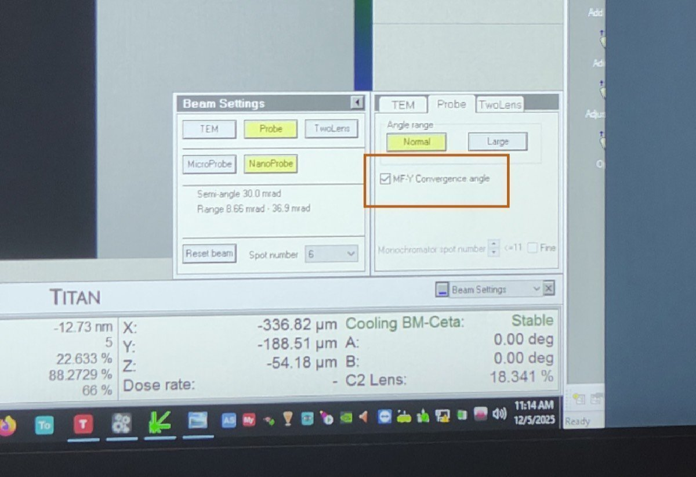

# Nanobeam diffraction

<strong>DRAFT</strong> — Nanobeam procedure under review.

Nanobeam diffraction (NBED) is a 4DSTEM experiment that uses a small convergence angle so the Bragg disks in each diffraction pattern stay separated and can be indexed. This page covers the beam settings that differ from the 30 mrad STEM default. For detector setup, acquisition, and end of session, follow [4DSTEM](index.md).

**Start on gold.** [Align the beam](../spectra_STEM/index.md#15-direct-alignments) and [tune the mono](../spectra_STEM/index.md#16-monochromator-tune).

## Step 1. Check and correct beam tilt {#repeat-alignment-in-nanobeam-mode}

1. In `Probe Corrector S-CORR`, open `Channels` → `Exported element`. Check whether `Beam Tilt` reads zero.
2. Open `Manual Correction` → `BeamTilt`. Set `Multiplier` to 6 and use the arrow keys to center the beam.

## Step 2. Align the diffraction pattern and fine-tune C2 {#step-4-align-the-diffraction-pattern-and-fine-tune-c2}

1. Switch to diffraction pattern (DP) mode. In `TEMUI`, select `Diffraction Shift and Focus alignment`. Center the pattern with `mulXY`, then click `Done`.
2. In `Apertures`, select `5` for C2. Click `Adjust`, center the aperture, then click `Adjust` again to exit.
3. Check for additional diffraction patterns or an off-center C2 aperture.
4. Leave DP mode. In real space, select `Center C2 aperture`. Adjust `mulXY` until the beam pulses in place, then click `Done`.

## Step 3. Retune the monochromator and check C3 {#step-5-retune-the-monochromator-and-check-c3}

1. Return to DP mode. Check the beam current. If it’s low, fine-tune `Shift` and `Focus` in `Monochromator Tune (Expert)`. Watch the current as you adjust.
2. Select the 20 µm C3 aperture. Check that only the selected aperture is visible. The beam current should be about 50 pA (0.050 nA).

See [Spectra monochromator tune](../spectra_STEM/index.md#16-monochromator-tune).

After the C3 check, [exchange the gold standard for your sample](../spectra_STEM/index.md#part-4-load-your-own-sample). See [finding your sample in LM](#find-the-sample-and-set-eucentric-height).

## Archive

Earlier draft and setup values.

<strong>Why change the convergence angle for 4DSTEM?</strong>

The convergence angle depends on the type of 4DSTEM experiment. For ptychography, 30 mrad (the same as standard STEM) works well because overlapping disks are part of the reconstruction. For nanobeam diffraction, where separated Bragg disks are needed to index reflections, a much smaller angle is used, typically 1 to 10 mrad depending on the material and the required disk separation.

Open [Electron microscopy tools](https://bobleesj.github.io/electron-microscopy-website/) and choose **Diffraction** to explore how convergence angle affects the CBED pattern.

### Nanobeam apertures and convergence angle on gold {#configure-beam-for-nanobeam-diffraction}

The default STEM setup uses C2 = 70 and 30 mrad convergence angle. For nanobeam diffraction, reduce both to get separated Bragg disks. See [setup values](#setup-values).

<strong>Why change the C2 aperture?</strong>

The C2 aperture limits the angular range of electrons entering the probe-forming optics. A smaller aperture (50 vs 70) blocks more off-axis electrons, producing a more coherent beam with cleaner diffraction patterns at each probe position. The C2 aperture size and convergence angle are proportional (approximately 7:1 ratio, e.g. C2 = 70 gives ~10 mrad).

> Confirm the C2 aperture to convergence angle ratio with staff.

1. In `TEMUI`, open `Tune` → `Apertures`. Change C2 from 70 to 50, and C3 from 1000 to 30.

   

2. In `Beam Setting`, click `MF-Y Convergence Angle`. Use the `mulY` knob to adjust the convergence angle to 10 mrad, then click `MF-Y Convergence Angle` again to deselect.

   

### Earlier alignment checks

Repeat the [Spectra direct alignments](../spectra_STEM/index.md#15-direct-alignments) at higher magnification with the nanobeam settings.

1. Stay in `STEM` on the gold standard. If `LM` is enabled, turn the magnification knob to leave it.
2. Align the C2 aperture. In `TEMUI` → `Tune` → `Direct Alignments`, select `Center C2 aperture`. Use `mulXY` until the beam pulses in place, then click `Done`.

   

3. Center the beam.
4. Adjust `Beam shift` in `Probe Corrector S-CORR`.

5. After monochromator tuning, recheck eucentric height on the gold standard.
6. Set the camera length to 230 mm (or 285 mm for a different angular range).

### Find your sample in LM and set eucentric height {#find-the-sample-and-set-eucentric-height}

1. Stay in `STEM`. Enable `LM` mode next to the `Descan` checkbox.
2. Use the stage joystick to find the region of interest in X and Y. Center a recognizable feature in that region.

3. To check eucentric height at this location, open `Stage²` → `Control` in `TEMUI` and turn on `Wobbler` under `Alpha wobbler`.

   
4. Watch the centered feature as the holder tilts back and forth. If it shifts across the image with each tilt, use the `Z-axis` up/down buttons on the hand panel to minimize that shift.
5. Turn off Wobbler. Recenter the feature if needed, then click Add beneath the position list in Stage² to save the position at this height.
6. Turn the magnification knob to leave `LM`. Continue to [4DSTEM Part 3: Acquisition](index.md#part-3-acquisition).

### STEM and nanobeam setup values {#setup-values}

| Parameter | STEM default | Initial nanobeam setup |
|-----------|-------------|---------------------|
| C2 aperture | 70 | 50 |
| C3 aperture | 1000 | 30 |
| Convergence angle | 30 mrad | ~10 mrad |
| Beam current | ~0.150 nA | ~0.032 nA |
| Camera length | 91 mm | 230 mm |
