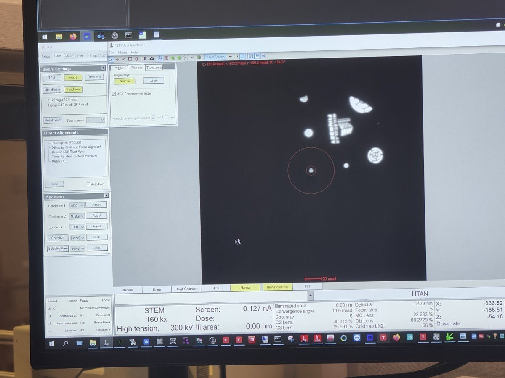
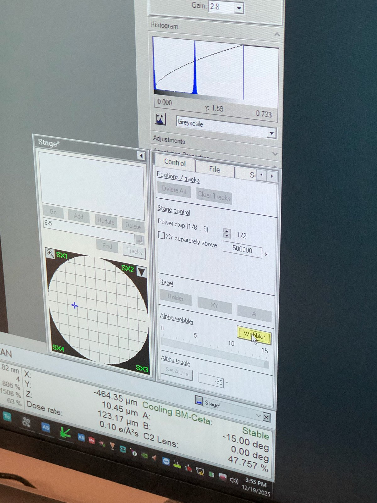
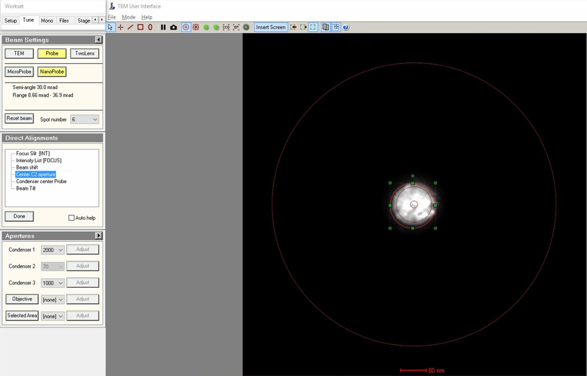

# Nanobeam diffraction

Nanobeam diffraction (NBED) is a 4DSTEM experiment that uses a small convergence angle so the Bragg disks in each diffraction pattern stay separated and can be indexed. This page covers the beam settings that differ from the 30 mrad STEM default. For detector setup, acquisition, and end of session, follow [4DSTEM](index.md).

**Prerequisite:** Complete [4DSTEM Part 1: Detector setup](index.md#part-1-detector-setup) and [Part 2: Beam setup](index.md#part-2-beam-setup) first. Then return to [Part 3: Acquisition](index.md#part-3-acquisition) after these steps.

<strong>Why change the convergence angle for 4DSTEM?</strong>

The convergence angle depends on the type of 4DSTEM experiment. For ptychography, 30 mrad (the same as standard STEM) works well because overlapping disks are part of the reconstruction. For nanobeam diffraction, where separated Bragg disks are needed to index reflections, a much smaller angle is used, typically 1 to 10 mrad depending on the material and the required disk separation.

**Interactive demo:** Explore how convergence angle affects the CBED pattern at [bobleesj.github.io/electron-microscopy-website/cbed](https://bobleesj.github.io/electron-microscopy-website/cbed)

## Step 1. Set the nanobeam apertures and convergence angle {#configure-beam-for-nanobeam-diffraction}

The default STEM setup uses C2 = 70 and 30 mrad convergence angle. For nanobeam diffraction, reduce both to get separated Bragg disks. The table below shows typical values:

| Parameter | STEM default | Nanobeam diffraction |
|-----------|-------------|---------------------|
| C2 aperture | 70 | 50 |
| C3 aperture | 1000 | 30 |
| Convergence angle | 30 mrad | ~10 mrad |
| Beam current | ~0.150 nA | ~0.032 nA |
| Camera length | 91 mm | 230 mm |

<strong>Why change the C2 aperture?</strong>

The C2 aperture limits the angular range of electrons entering the probe-forming optics. A smaller aperture (50 vs 70) blocks more off-axis electrons, producing a more coherent beam with cleaner diffraction patterns at each probe position. The C2 aperture size and convergence angle are proportional (approximately 7:1 ratio, e.g. C2 = 70 gives ~10 mrad).

> Confirm the C2 aperture to convergence angle ratio with staff.

1. In `TEMUI`, open `Tune` → `Apertures`. Change C2 from 70 to 50, and C3 from 1000 to 30.

   

2. In `Beam Setting`, click `MF-Y Convergence Angle`. Use the `mulY` knob to adjust the convergence angle to 10 mrad, then click `MF-Y Convergence Angle` again to deselect.

   

## Step 2. Find the sample in LM and set eucentric height {#find-the-sample-and-set-eucentric-height}

1. Stay in `STEM`. Enable `LM` mode next to the `Descan` checkbox.
2. Use the stage joystick to find the region of interest in X and Y. Center a recognizable feature in that region.

3. To check eucentric height at this location, open `Stage²` → `Control` in `TEMUI` and turn on `Wobbler` under `Alpha wobbler`.

   
4. Watch the centered feature as the holder tilts back and forth. If it shifts across the image with each tilt, use the `Z-axis` up/down buttons on the hand panel to minimize that shift.
5. Turn off Wobbler. Recenter the feature if needed, then click Add beneath the position list in Stage² to save the position at this height.

## Step 3. Repeat the alignment at higher magnification {#repeat-alignment-in-nanobeam-mode}

You aligned the beam during the initial STEM setup. With the nanobeam apertures and convergence angle in place, repeat the alignment checks below, then tune the monochromator. For the full procedures, see the Spectra guide’s [Direct alignments](../spectra_STEM/index.md#15-direct-alignments) and [Monochromator tune](../spectra_STEM/index.md#16-monochromator-tune).

1. After saving the stage position, stay in `STEM` and turn the magnification knob to leave `LM`.
2. Align the C2 aperture. In `TEMUI` → `Tune` → `Direct Alignments`, select `Center C2 aperture`. Use `mulXY` until the beam pulses in place, then click `Done`.

   

3. Center the beam.
4. Adjust `Beam shift` in `Probe Corrector S-CORR`.
5. Check beam tilt.

   > Confirm whether the arrow keys were used to adjust beam tilt in `Probe Corrector S-CORR` and which control was selected.

6. Return to the diffraction view and select `Diffraction Shift and Focus alignment`. Check that the ronchigram is centered, adjust with `mulXY` if needed, then click `Done`.
7. Open `Mono` → `Monochromator Tune (Expert)` in `TEMUI` and center the beam through the slit. With `Focus` active, use the intensity knob to set the nanobeam current to ~0.032 nA.
8. Recheck eucentric height after adjusting the monochromator.
9. Set the camera length to 230 mm (or 285 mm depending on the required angular range for your material).
