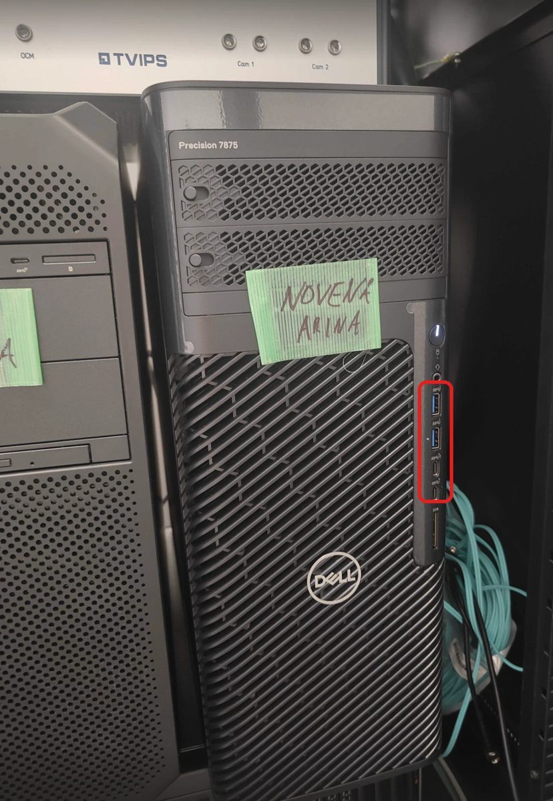
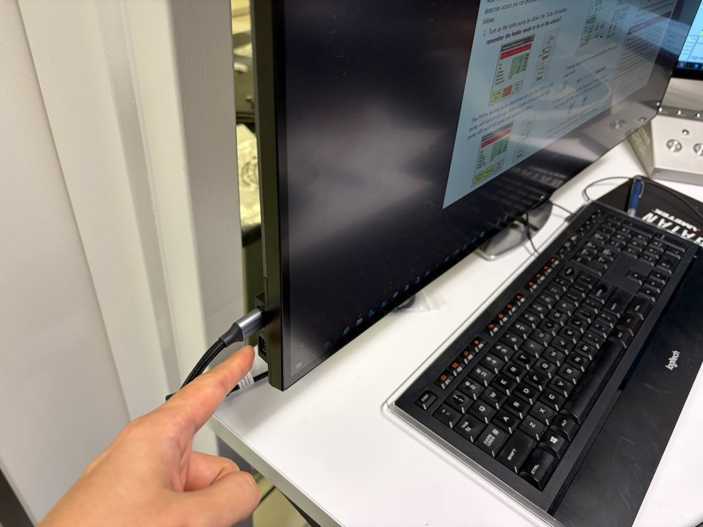
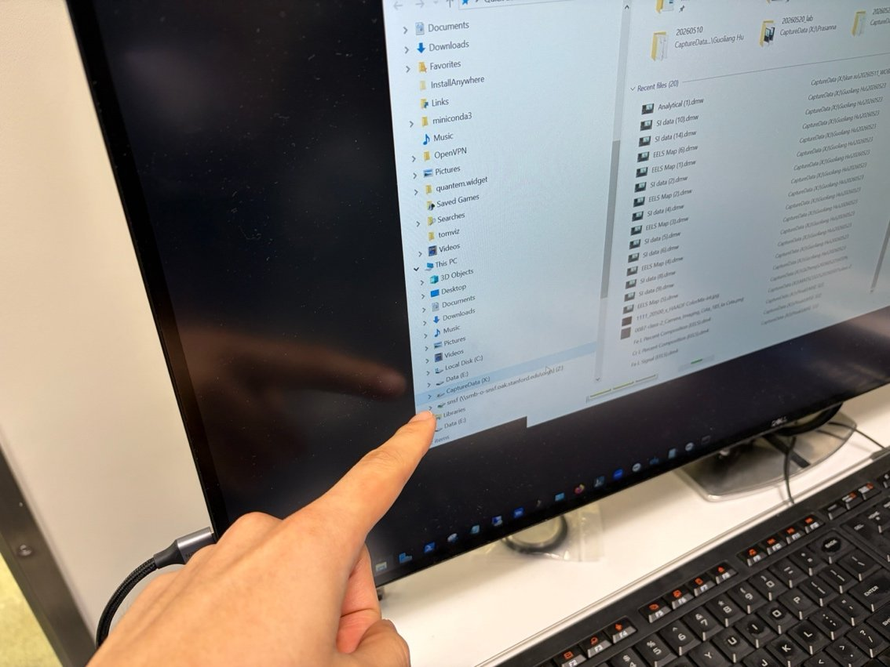
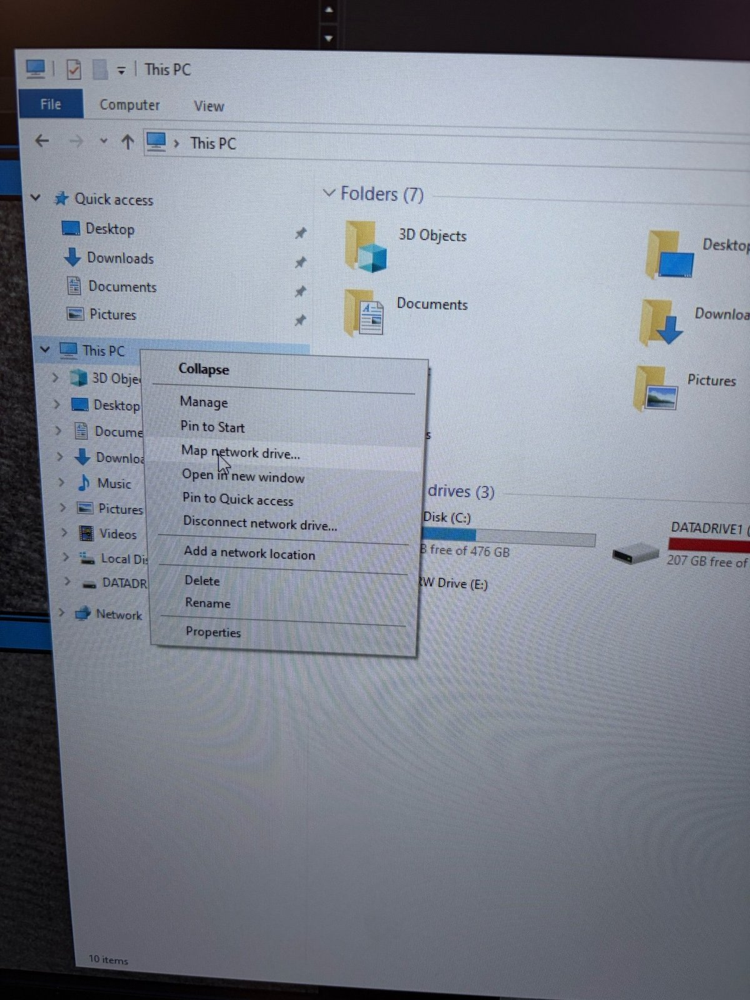
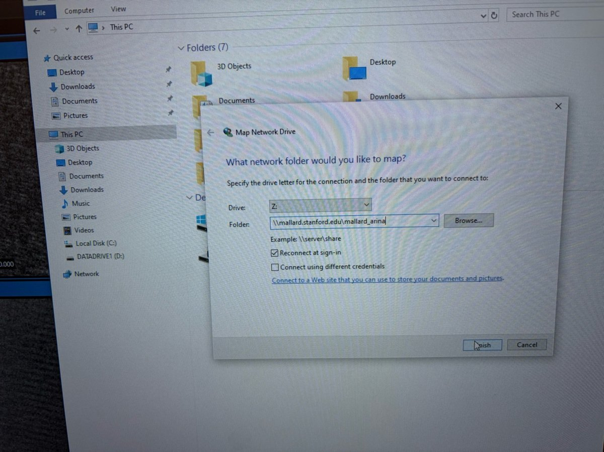

# Data transfer: Arina and Velox

This page covers how to get your data off the Spectra computers at Stanford SNSF: Arina 4DSTEM datasets and Velox HAADF `.emd` images to a USB drive, plus how to mount the Wigeon network share (Colin Ophus group only) for remote access. Drafted by Sangjoon Bob Lee from staff notes and images. Arina PC photo by Guoliang Hu.

> **TODO:** The Arina PC was replaced with a new computer (Oct 2026). Verify the copy steps on the new PC, then update the Arina section below.

## Overview

| Task | How |
| ---- | --- |
| [Save Arina 4DSTEM data to USB](#save-arina-4dstem-data-to-usb) | Plug USB into the Arina PC, copy the dataset |
| [Save HAADF images to USB](#save-haadf-images-to-usb) | Copy Velox `CaptureData` folder to USB |
| [Mount the Wigeon network share](#mount-the-wigeon-network-share) | Map the Wigeon share as a network drive (Colin Ophus group only) |

## Save Arina 4DSTEM data to USB

Plug your USB into the Arina PC (the Dell labeled "NOVENA ARINA", USB ports circled below), then copy your dataset to it.

## Save HAADF images to USB

Velox saves HAADF images and other `.emd` files locally on the control workstation.

- [ ] **Plug in the USB drive**

  1. Insert your USB drive into the PC. It appears as a new drive in File Explorer.

     

- [ ] **Find the CaptureData folder and copy**

  1. Open the `CaptureData (X:)` folder. Velox saves your session's `.emd` files here, organized by date.
  2. Copy your dated folder to the USB drive.

     

## Mount the Wigeon network share

> **NOTE:** For Colin Ophus group members only.

For remote access to the lab data server, map the Wigeon share as a network drive instead of copying to USB.

- [ ] **Open Map network drive**

  1. In Windows File Explorer, right-click `This PC` and select `Map network drive...`.

     

- [ ] **Enter the share path**

  1. Set `Drive` to `W:` and `Folder` to `\\wigeon\streaming`.
  2. Check `Reconnect at sign-in`, then click `Finish`.
  3. Enter the password when prompted. The password is in the pinned message of the `colab-compute` Slack channel.

     > **Placeholder** — REPLACE with wigeon.

     
